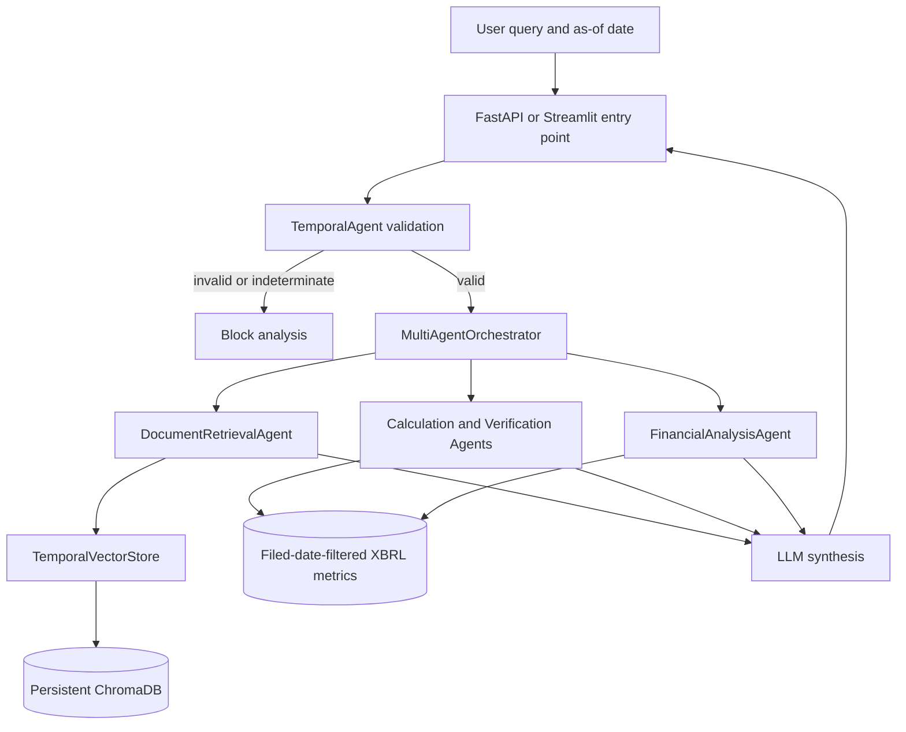

# TemporalGuard-RAG

A research prototype for financial question answering that applies point-in-time constraints to SEC document retrieval and XBRL-based financial analysis. It is intended for experimentation and review, not investment decisions or production deployment.

## Why Temporal Constraints Matter

A financial RAG system can retrieve a filing or metric that describes an earlier reporting period but was published only after the historical analysis date. Using that information in a backtest introduces look-ahead bias. TemporalGuard-RAG tracks filing dates and applies an as-of cutoff to retrieval and structured financial observations.

## Capabilities

Implemented in the current code:

- ChromaDB retrieval with ticker and filing-date metadata filters.
- Temporal query validation, including quarter-period checks and filing-lag heuristics.
- XBRL metric lookup and financial calculations with filing-date filtering.
- Multi-agent analysis orchestration and synthesis through LangGraph/LangChain.
- Ollama and OpenAI chat-model providers.
- FastAPI applications, a React/Vite client, and a Streamlit interface.

Experimental or limited:

- Financial projections, ratios, and confidence intervals are illustrative analysis tools. They are not independently calibrated for investment use.
- Hallucination checks are heuristic and cover only supported data paths; they do not verify every number in every generated answer.
- Provenance, poisoning detection, and audit modules exist, but this repository does not demonstrate a complete compliance or security program.

## Architecture



Document retrieval applies a Chroma metadata filter before returning evidence. Structured XBRL lookups also filter observations by their filing date. The orchestration layer blocks queries when temporal validation reports a violation or fails.

## Technology

- Python 3.13-tested runtime; FastAPI, Pydantic, Streamlit
- LangChain/LangGraph for model and agent orchestration
- ChromaDB and SentenceTransformers for vector retrieval
- pandas and NumPy for financial data processing
- React 18, TypeScript, Vite, and Tailwind CSS
- pytest and npm for automated checks and frontend builds

## Repository Layout

```text
backend/main.py                 Async job API used by the React client
api.py                          Separate synchronous/versioned FastAPI API
streamlit_app.py                Direct Streamlit interface
src/agents/                     Orchestrator and specialist agents
src/analysis/                   XBRL loading, formulas, projections, metrics
src/preprocessing/              Filing chunking and embedding generation
src/rag_system/                 ChromaDB and temporal retrieval
src/evaluation/                 Experimental evaluation code
scripts/ingest_all.py           Data-collection CLI
config/                         Settings model (not all settings drive runtime)
data/                           Local raw and processed data (mostly ignored)
frontend/                       React/Vite user interface
tests/                          pytest suite
```

## Requirements

- Python 3.13 is the tested version for this checkout. The dependency manifest uses version ranges, so installations can resolve newer compatible releases.
- Node.js 18 or newer and npm for the React frontend.
- Ollama with the `llama3.2` model for local LLM inference, or an OpenAI API key for the OpenAI provider.
- Local SEC/XBRL data and an indexed Chroma collection for meaningful evidence-backed answers. Data files and the persisted vector database are not distributed with the repository.

## Install

From the repository root, create and activate a virtual environment, then install Python dependencies:

```powershell
py -3.13 -m venv .venv
.\.venv\Scripts\Activate.ps1
python -m pip install --upgrade pip
python -m pip install -r requirements.txt
Copy-Item .env.example .env
```

For the frontend:

```powershell
Set-Location frontend
npm ci
```

The Python dependencies include PyTorch and SentenceTransformers and can require a substantial download. The default embedding model is `sentence-transformers/all-MiniLM-L6-v2` (384 dimensions); preprocessing and retrieval must use the same embedding model and dimension. If the model is not cached, set `TEMPORAL_GUARD_ALLOW_MODEL_DOWNLOAD=1` to allow its download.

`requirements-windows-py313.lock` pins the Windows/Python 3.13 environment used by CI. It is platform-specific; use `requirements.txt` on other operating systems and verify that platform's resolved dependencies.

## Model Configuration

The default provider is Ollama (`llama3.2` at `http://localhost:11434`). Install and start Ollama separately, then retrieve the model:

```powershell
ollama pull llama3.2
```

To use OpenAI, set `OPENAI_API_KEY` in `.env`. The provider factory selects OpenAI when that variable is present; otherwise it selects Ollama. The React API request currently selects Ollama explicitly. Do not commit `.env` or put credentials in logs or issue reports.

`SEC_EMAIL` is only needed by `scripts/ingest_all.py` when downloading SEC material. It is not required to start the APIs against an already-populated local data directory.

## Start the Applications

### React frontend and async API

In one terminal, from the repository root:

```powershell
.\.venv\Scripts\Activate.ps1
python -m uvicorn backend.main:app --reload --port 8000
```

In a second terminal:

```powershell
Set-Location frontend
npm run dev
```

Open <http://localhost:3000>. Vite proxies `/api` requests to `http://localhost:8000`. This backend provides queued analysis jobs and in-memory job status; jobs are lost when the process restarts. Its React-facing routes include `POST /api/analyze`, `GET /api/jobs/{job_id}`, `GET /api/tickers`, and `GET /api/stats`. Additional `/api/market/*` routes use external Yahoo Finance data and require network access.

Example analysis request:

```json
{
  "query": "What was Apple's revenue in Q3 2023?",
  "ticker": "AAPL",
  "analysis_date": "20231115",
  "provider": "ollama",
  "model_name": "llama3.2",
  "fast_mode": true
}
```

The submit route returns a queued job identifier:

```json
{
  "job_id": "<generated-id>",
  "status": "queued",
  "message": "Analysis started"
}
```

Poll `GET /api/jobs/{job_id}` for status, stage information, and (when completed) `final_answer`, `stages`, and `metadata`.

### Separate versioned API

Root `api.py` is a distinct synchronous FastAPI application with different routes and response schemas. Start it on another port:

```powershell
.\.venv\Scripts\Activate.ps1
python -m uvicorn api:app --reload --port 8001
```

Open <http://localhost:8001/docs>. It includes `POST /api/v1/analyze`, `/api/v1/validate-temporal`, `/api/v1/calculate`, `/api/v1/verify`, plus health and ticker routes. The React client does not use this API.

### Streamlit

From the repository root:

```powershell
.\.venv\Scripts\Activate.ps1
streamlit run streamlit_app.py
```

The Streamlit app calls the orchestrator directly in its process; it does not call either FastAPI application.

## Data Ingestion and Indexing

Data collection is optional and requires external network access. For a small SEC/XBRL collection:

```powershell
python scripts/ingest_all.py --sec --xbrl --tickers AAPL --sec-email your-address@example.com
```

The current ingestion CLI collects source data but is not a single turnkey command for building every derived artifact and the Chroma index. The preprocessing modules expect their documented local inputs (`data/raw/sec_filings`, processed chunks, and embedding files). Review their defaults before running a full corpus job; indexing can consume significant disk, memory, model-download bandwidth, and time. Do not point a test at the default persistent database.

The vector store defaults to `data/processed/vector_db` and collection `temporal_financial_docs`. The regression suite uses an isolated temporary collection. Existing local database contents are not included in Git and are not automatically rebuilt by the app.

## Point-in-Time Behavior

- `TemporalAgent` checks future year and quarter references. Q1-Q3 use the configured 10-Q lag; Q4 uses the 10-K lag. These are conservative heuristics, not a substitute for issuer-specific filing timestamps.
- Explicit projection-intent queries may name future target years. Their historical inputs still pass through filing-date filters; a future year in a historical question is rejected.
- The orchestrator stops before downstream agents when validation detects a violation or cannot validate the date.
- `TemporalVectorStore.temporal_search()` filters by integer `filing_date < cutoff_date` and, when provided, ticker and filing type. The strict comparison excludes documents filed on the cutoff date.
- For structured metrics, `FinancialDataLoader` and `CalculationAgent` require a filing date on or before the as-of date. Missing or malformed filing dates are excluded from as-of histories.
- Reporting-period end dates, filing dates, and ingestion dates are distinct. The historical metric cutoff uses filing date; reported quarter availability is estimated by the TemporalAgent's lag rules.
- Current market information is withheld for historical analysis dates; historical market-price reconstruction is not implemented in that path.

The current temporal checks do not establish complete end-to-end safety for every possible tool, external market-data source, cached artifact, or prompt-injection scenario. Treat results as research output and inspect their sources.

## Numeric Verification

The VerificationAgent can search temporally filtered documents and compare supported numeric claims against local XBRL metric CSVs. Its coverage depends on the available metric mappings and data. It is not a universal claim extractor or a formal assurance system; heuristic confidence labels should not be interpreted as calibrated probabilities.

## Tests and Evaluation

Run the Python test suite from the repository root:

```powershell
.\.venv\Scripts\python.exe -m pytest -q
```

Run the frontend type check and production build:

```powershell
Set-Location frontend
npm run build
```

The regression tests use synthetic filings and a temporary Chroma database. One full-flow VerificationAgent test remains skipped because it requires real XBRL data and an LLM environment.

GitHub Actions runs Python tests on Windows/Python 3.13 from the platform lock and builds the frontend on Node.js 20.

`src/evaluation/comprehensive_eval.py` contains experimental temporal, uncertainty, and hallucination evaluators. Existing JSON metric artifacts in `results/evaluation/` are previously reported local outputs; they have not been independently reproduced for this README and should not be treated as validated benchmark results. A credible evaluation still needs a versioned dataset, documented train/test separation, issuer/date ground truth, baselines, repeated runs, and independently checked metric calculations.

## Limitations

- No authentication or user authorization is implemented. Bind these development APIs to a trusted local interface; do not expose them directly to the public internet.
- No Docker, Compose, or deployment configuration is included.
- The general backend dependencies are version-ranged; the exact lock provided is specific to Windows/Python 3.13. The frontend has `package-lock.json` and should be installed with `npm ci`.
- The React backend stores jobs in memory and does not persist them across restarts.
- Local data, Chroma state, and model availability determine whether analysis can retrieve evidence. Empty or stale data can produce empty results.
- Temporal and confidence heuristics are research approximations. The project is not investment advice and has not undergone a production security, compliance, or reliability review.

## Potential Next Steps

- Add issuer-specific filing-calendar data and broader point-in-time tests against archived filing timestamps.
- Build a versioned evaluation set with reproducible baselines and independent metric verification.
- Persist asynchronous jobs and add authenticated access before supporting shared or remote use.

## License

The repository includes an MIT license. See [LICENSE](LICENSE).
